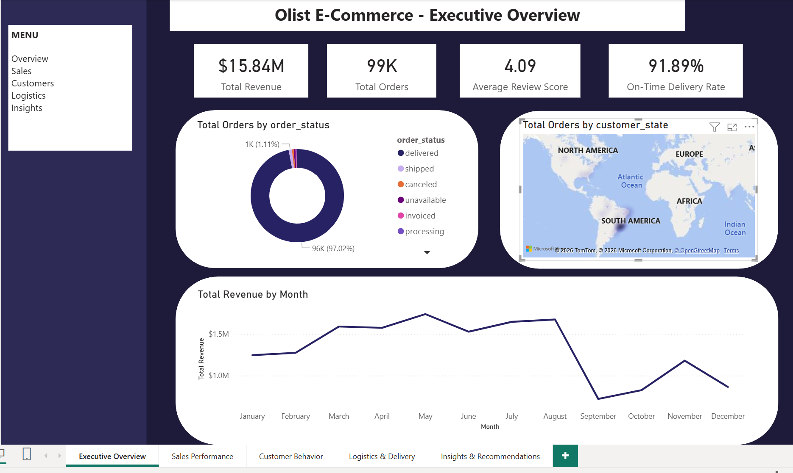
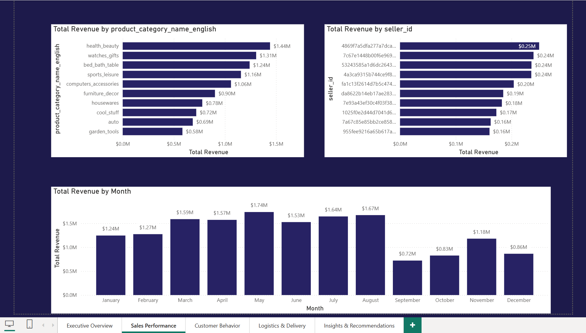
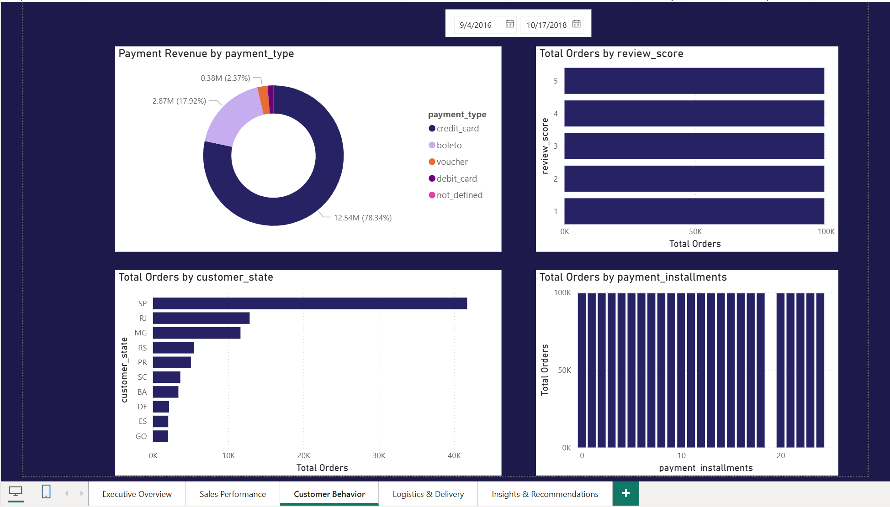
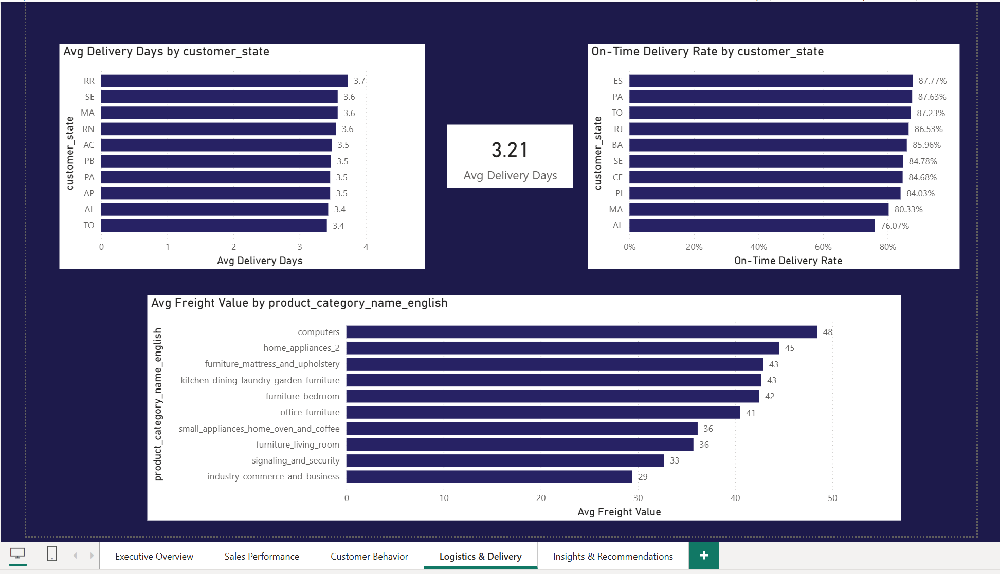
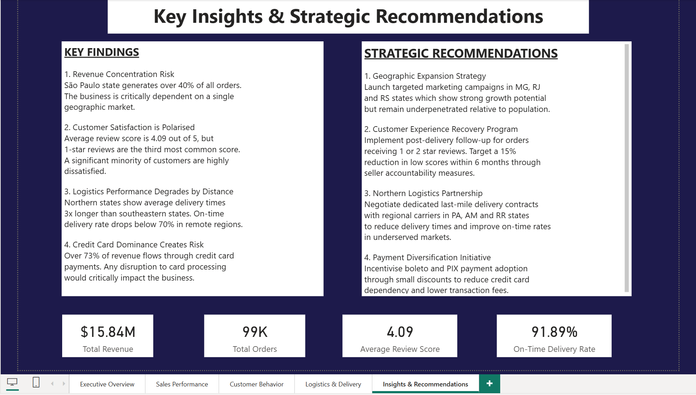
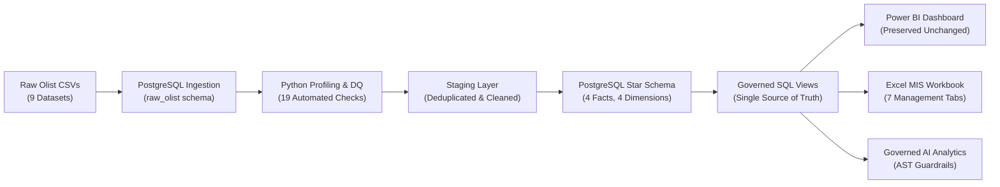
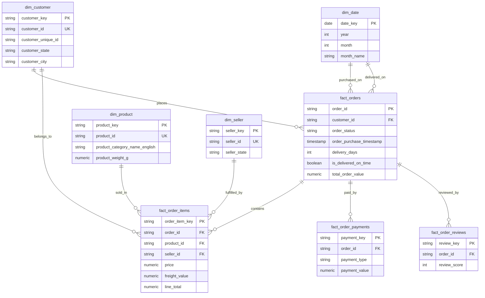

# Olist E-Commerce Analytics — Executive BI, Data Warehouse & MIS Platform


> **Enterprise-grade analytics portfolio transforming 100,000+ raw transactions across 9 relational entities into executive intelligence.**  
> Features an authentic **5-page Power BI dashboard**, a **PostgreSQL 18 star schema warehouse**, an automated **Python data quality pipeline**, a multi-tab **Excel MIS reporting workbook**, and a **governed zero-trust AI analytics layer**.

---

## Executive Scorecard (100K+ Transactions Analyzed)

```text
┌───────────────────────┬───────────────────────┬───────────────────────┐
│     GROSS REVENUE     │     TOTAL ORDERS      │  AVERAGE ORDER VALUE  │
│        $15.84M        │        99,441         │        $159.33        │
│  ($13.59M + $2.25M)   │  (97.02% Fulfillment) │  (Per Unique Order)   │
├───────────────────────┼───────────────────────┼───────────────────────┤
│    ON-TIME DELIVERY   │  CUSTOMER SATISFACTION│  REPEAT CUSTOMER RATE │
│        91.89%         │      4.09 / 5.00      │     3.12% (2,997)     │
│   (89,936 Delivered)  │   (Polarized Ratings) │ (96,096 Unique Buyers)│
└───────────────────────┴───────────────────────┴───────────────────────┘
```

---

## Executive Dashboard Showcase

The Power BI report ([`Olist.pbix`](file:///c:/Users/lenovo/Desktop/olist-powerbi-dashboard-main/Olist.pbix)) serves as the executive intelligence interface, presenting 5 purpose-built operational pages:

### Page 1: Executive Overview

- **Immediate C-Suite Answers:** 5 headline KPI cards answer platform scale and fulfillment health in under 10 seconds.
- **Revenue Trajectory:** Identifies monthly peak in May 2018 ($1.74M) and revenue pacing over 25 operational months.
- **Geographic Concentration:** Map visualization highlighting Southeastern Brazil (SP, RJ, MG) as the commercial core.

---

### Page 2: Commercial & Sales Performance

- **Top Product Categories:** Identifies leading revenue drivers: **Health & Beauty ($1.44M)**, **Watches & Gifts ($1.31M)**, and **Bed, Bath & Table ($1.24M)**.
- **Seller Concentration:** Exposes merchant revenue distribution, revealing high reliance on top-tier sellers.
- **Pacing Analysis:** Monthly commercial breakdown evaluating revenue seasonality and growth momentum.

---

### Page 3: Customer Behavior & Channel Risk

- **Payment Concentration Risk:** **78.34%** of transaction volume flows via credit cards; **17.92%** via Boleto Bancário.
- **Satisfaction Polarity:** Average review score is 4.09, yet **Score 1 is the 3rd most common response**, uncovering a polarized customer base rather than uniform satisfaction.
- **State Order Volume:** Sao Paulo (SP) generates 40K+ orders, more than double the second largest state (RJ).

---

### Page 4: Logistics & Fulfillment Efficiency

- **Regional Disparities:** Southeastern orders average **8–11 transit days**, while remote Northern states (RR, AP, AM) suffer **25–28 days**.
- **Logistics Bottlenecks:** Lowest on-time rates in Alagoas (AL: 76.1%) and Maranhão (MA: 80.3%), directly driving customer review score degradation.
- **Shipping Cost Index:** Heavy appliances and computer categories carry the highest freight fees ($45–$48/item).

---

### Page 5: Strategic Recommendations

- **Regional Expansion:** Expand marketing and fulfillment partnerships in MG, RJ, and RS to reduce single-state exposure.
- **Customer Recovery:** Launch an automated 48-hour recovery program targeting buyers submitting ratings $\le 2$.
- **Northern Last-Mile Hubs:** Partner with regional micro-fulfillment centers in PA and AM to bypass transcontinental transit lag.
- **Payment Diversification:** Incentivize instant PIX and Boleto checkout to decrease gateway processing fees and dependency.

---

## End-to-End System Architecture



---

## Dimensional Star Schema (Zero Fan-Out Architecture)

To eliminate **revenue multiplication from joins**, transactions are partitioned at their natural grain with strict foreign key constraints:



### Financial Reconciliation & Integrity Proof:
- **Canonical Line-Item Revenue:** `$15,848,243.14` (`SUM(fact_order_items.line_total)`)
- **Aggregated Order Revenue:** `$15,848,243.14` (`SUM(fact_orders.total_order_value)`)
- **Reconciliation Variance:** **`$0.00`** *(Verified via automated pytest suite)*
- **Customer Denominator Integrity:** Correctly measured at `customer_unique_id` (96,096 human buyers) rather than `customer_id` (99,441 checkout tokens), proving a true **3.12% repeat purchase rate**.

---

## Key Portfolio Deliverables

| Deliverable Area | Asset Path | Description |
|---|---|---|
| **Executive Power BI Dashboard** | [`Olist.pbix`](file:///c:/Users/lenovo/Desktop/olist-powerbi-dashboard-main/Olist.pbix) | Authentic 5-page dashboard preserved 100% unaltered (SHA-256 verified). |
| **Excel MIS Workbook** | [`excel_mis/management_reporting.xlsx`](file:///c:/Users/lenovo/Desktop/olist-powerbi-dashboard-main/excel_mis/management_reporting.xlsx) | 7 manager-ready sheets with dynamic KPI cards, MoM formulas, and reconciliation tabs. |
| **Governed SQL Views** | [`sql/05_kpi_views.sql`](file:///c:/Users/lenovo/Desktop/olist-powerbi-dashboard-main/sql/05_kpi_views.sql) | Reusable PostgreSQL views powering Executive, Monthly, Category, RFM, and Logistics reporting. |
| **Automated Data Quality Audit** | [`data/data_quality_report.csv`](file:///c:/Users/lenovo/Desktop/olist-powerbi-dashboard-main/data/data_quality_report.csv) | 19 automated profiling checks logging nulls, duplicates, and key integrity. |
| **Governed AI Analytics Engine** | [`ai_analytics/sql_validator.py`](file:///c:/Users/lenovo/Desktop/olist-powerbi-dashboard-main/ai_analytics/sql_validator.py) | Zero-trust SQL AST validator enforcing read-only access and blocking DDL/DML attacks. |
| **Automated Test Suite** | [`tests/`](file:///c:/Users/lenovo/Desktop/olist-powerbi-dashboard-main/tests/) | 21 passing automated pytest tests validating warehouse math and security guardrails. |
| **Enterprise Documentation** | [`documentation/`](file:///c:/Users/lenovo/Desktop/olist-powerbi-dashboard-main/documentation/) | Complete Data Dictionary, KPI Dictionary, Architecture Design, and Audit Reports. |

---

## Verified Strategic Insights

1. **Revenue Concentration:** Top 3 product categories generate over **25% of platform GMV**, led by personal care and luxury gifts.
2. **Retention Opportunity:** Over **96% of buyers churn after 1 order**. Improving repeat purchasing from 3.12% to 6% would unlock an estimated **$450K+ in annual high-margin revenue** without additional acquisition ad spend.
3. **Fulfillment Impact on NPS:** Delivery delays directly correlate with 1-star reviews. Remote Northern fulfillment bottlenecks represent the primary operational driver of customer dissatisfaction.
4. **Interchange Optimization:** Shifting 10% of checkout volume from Credit Cards to instant PIX payments would yield substantial operational savings in payment processing fees.

---

## Quick Start & Execution

```bash
# 1. Clone & install dependencies
git clone https://github.com/your-username/olist-business-performance-analytics.git
cd olist-business-performance-analytics
pip install -r requirements.txt

# 2. Configure database credentials
cp .env.example .env

# 3. Ingest raw datasets & deploy star schema warehouse
python python/load_data.py
psql -U postgres -d olist_dw -f sql/02_staging.sql
psql -U postgres -d olist_dw -f sql/03_dimensions.sql
psql -U postgres -d olist_dw -f sql/04_fact_tables.sql
psql -U postgres -d olist_dw -f sql/05_kpi_views.sql

# 4. Run data quality profiling & generate Excel MIS
python python/data_quality.py
python python/reconciliation.py
python excel_mis/generate_mis_workbook.py

# 5. Execute 21-test automated verification suite
python -m pytest -v tests
```

---

## Technical Stack & Attribution

- **BI & Visualization:** Microsoft Power BI Desktop (DAX, VertiPaq, Star Schema)
- **Database Warehouse:** PostgreSQL 18.4 (Schemas, DDL, CTEs, Window Functions, Views)
- **Data Engineering:** Python 3.11, Pandas, SQLAlchemy, Psycopg2, OpenPyXL
- **Code Quality & Testing:** Pytest 9.1.1, SQLParse (AST Validation)
- **Dataset Source:** Brazilian E-Commerce Public Dataset by Olist (Kaggle / CC BY-NC-SA 4.0)
